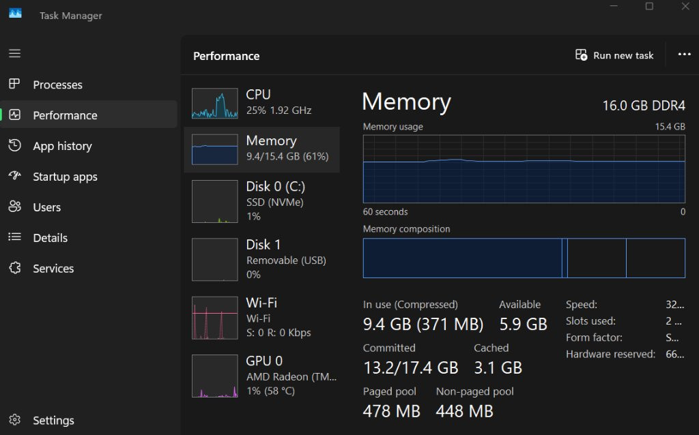
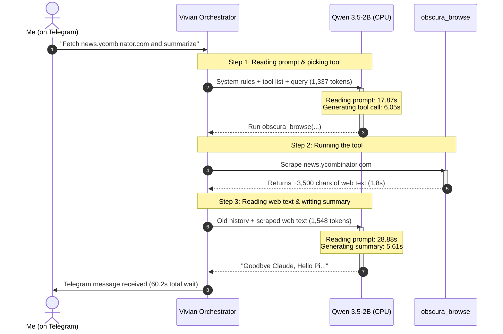
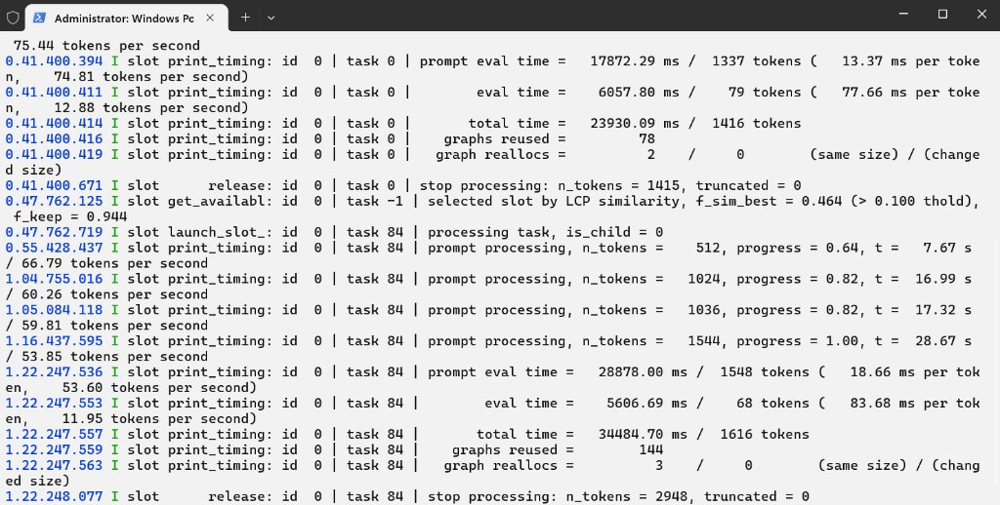
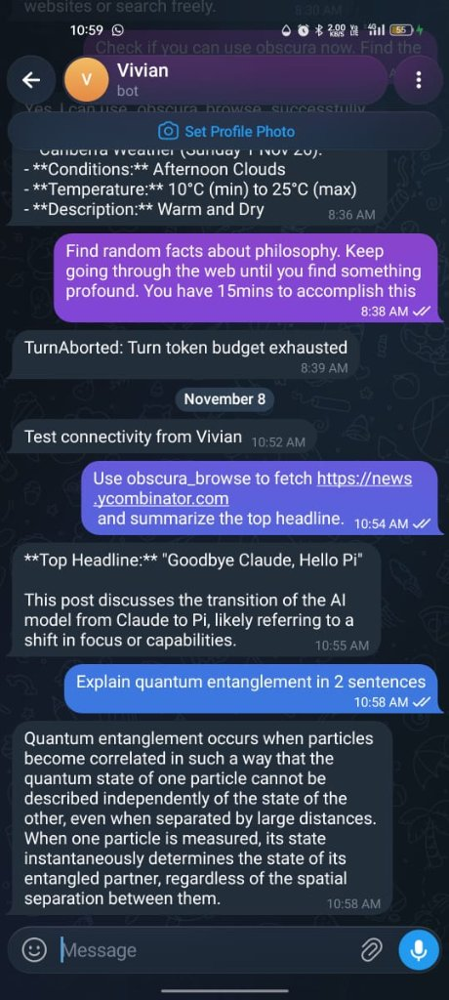
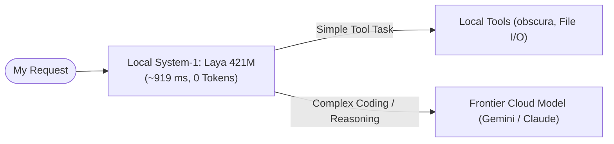
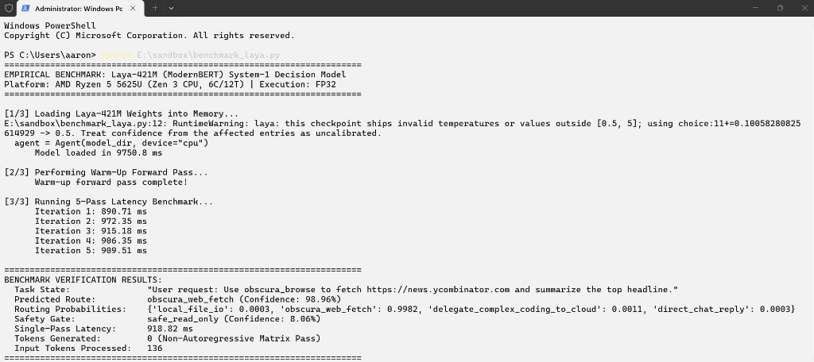

# Why a System-1 Decision Model Beat a Small Local LLM on My Laptop

**Author:** myne (`mvyne06`)  
**Hardware:** AMD Ryzen 5 5625U (6 Cores / 12 Threads), 16 GB DDR4-3200 RAM, Integrated AMD Radeon Graphics  
**Repository:** [github.com/mvyne06/edge-agent-bottlenecks](https://github.com/mvyne06/edge-agent-bottlenecks)  
**Tooling & Attribution:** Project narrative, hardware setup, and testing by `myne`; terminal log profiling, architectural diagrams, and benchmark formatting assisted by Google Antigravity.

---

## 1. Project Motivation & Narrative

My goal was to run an SLM locally and connect it to a cloud LLM environment (Google Antigravity). However, this didn't end up working as I expected.

The original plan was:
1. Set up Qwen 3.5-4B (later changed to a 2B model due to horrible performance).
2. Set up a Telegram bot connected to the model.
3. Keep the model running permanently on my hardware.
4. Connect it to Google Antigravity or OmniRoute (an API routing bridge) so that it could build things on its own.
5. Have it be my assistant when needed, and during downtime let it do whatever it wanted.

**Laptop specs:** AMD Ryzen 5 5625U, 16 GB DDR4-3200 RAM (dual channel).

I originally tried running Qwen 3.5-4B as it scored the highest on benchmarks and seemed the best at the time. `llama.cpp` was set up using Vulkan so that the model ran on the iGPU to be more efficient. In this case, the iGPU and CPU share the same bus and RAM, but my reasoning was that the iGPU should be more efficient since it's better at matrix math.

The performance was really bad; it took really long for the model to do anything, even simple tasks. I tried switching to the CPU, but that didn't do much. So I caved and switched to an even smaller model (Qwen 3.5-2B). The performance boost was marginal.

I was going to call it quits, but then I remembered reading about Jev. That got me thinking if there was an open-source System-1 decision model—**AND THERE WAS!** Laya was the obvious choice, and it runs comfortably on my hardware.

Frontier cloud models (like Gemini, Claude, GPT, or DeepSeek/Qwen cloud flagships) outcompete local models tenfold. On lower-end hardware, it doesn't make sense to run even small text-generation models for multi-step agent tasks when they bottleneck on hardware. So I'm sticking to using fast System-1 decision models locally, and offloading heavy reasoning to cloud models.

---

## 2. Hardware Bottlenecks: Memory Bandwidth & Vulkan vs. CPU

My laptop uses an AMD Ryzen 5 5625U chip where the CPU cores and the Radeon iGPU share the same DDR4 system memory:

```
+--------------------------------------------------------------+
|             AMD Ryzen 5 5625U (15W Laptop Chip)              |
|  +-------------------------+    +-------------------------+  |
|  |   6 Zen 3 CPU Cores     |    |   Radeon Vega 7 (iGPU)  |  |
|  +-------------------------+    +-------------------------+  |
|               |                              |               |
|               +--------------+---------------+               |
|                              |                               |
|                  Shared Memory Controller                    |
+------------------------------+-------------------------------+
                               |
             +-----------------+-----------------+
             |   16 GB DDR4-3200 (Dual Channel)  |
             +-----------------------------------+
```

Because the model has to load its weights from shared DDR4 RAM for every word it writes, the smaller 2B model (~1.34 GB, ~12–15 tokens/sec) was roughly twice as fast at typing as the 4B model (~2.8 GB, ~7.4 tokens/sec).

### Why Vulkan iGPU Mode Didn't Help
I thought running the model on the iGPU via Vulkan would be faster. But because the iGPU doesn't have its own dedicated VRAM and shares the exact same RAM as the CPU, Vulkan just added extra driver overhead. It also pushed my RAM usage up to **12.5 GB (81%)**.

When I switched `llama-server` to use 6 CPU threads directly (`-ngl 0 -t 6`), generation speed stayed about the same, but my RAM usage dropped down to **9.4 GB (61%)** and CPU load settled around 25%, leaving my laptop much cooler and more responsive.


*Figure 1: Task Manager showing 9.4 GB (61%) RAM usage and 25% CPU load running on 6 threads (compared to 12.5 GB / 81% RAM under Vulkan).*

---

## 3. Why Multi-Step Tool Calls Were So Slow (Prompt Reading Time)

Seeing 12–15 tokens/sec on paper made me think Qwen 3.5-2B would feel reasonably fast. But the moment I asked the bot to do a real task—like using `obscura` to fetch Hacker News and summarize the top post—it took **over 60 seconds** to respond.

When I checked the `llama-server` terminal logs, I realized the problem wasn't typing speed. The real bottleneck was **prompt evaluation time** (the time the model spends reading the text before it can write anything):



### The Real Numbers from My Terminal
Looking at my `llama-server` terminal log in Figure 2:
1. **Step 1:** The model spent **17.87 seconds** just reading the prompt and tool instructions (1,337 tokens), and 6.05 seconds generating the tool call.
2. **Tool Step:** `obscura.exe` fetched the web page in **1.8 seconds**.
3. **Step 2:** When the web text was added back into the prompt (1,548 tokens), the model spent another **28.88 seconds** just reading it, and 5.61 seconds writing the short summary.
4. **Total Time:** **~58.4 seconds of model time** (**60.2 seconds total** with the web fetch).

Out of that 60.2-second wait, the model spent **46.75 seconds (80%) just reading prompts**.


*Figure 2: My terminal output showing 17.87s and 28.88s spent reading prompts.*

### The Negative Result: Open-Ended Loops Fail
When I gave the bot a bounded single-step task, it worked (it pulled the headline *"Goodbye Claude, Hello Pi"*). But when I gave it an open-ended autonomous prompt (*"Find random facts about philosophy... Keep going through the web"*), the 2B model got stuck re-reading growing context over and over until my watchdog killed it (`TurnAborted: Turn token budget exhausted`).


*Figure 3: Telegram showing the open-ended task aborting after running out of tokens, next to the successful Hacker News test.*

---

## 4. The Solution: Using Laya for Fast System-1 Routing

After seeing a 2B model take 24 seconds just to decide to run `obscura`, I realized asking a text-generation model to be the "brain" on a laptop doesn't make sense.

Instead, I split the work:
* **System 1 (Local):** Use a fast decision model (**Laya**, 421M parameters) locally to inspect the user's message, pick the right tool, and check if it's safe.
* **System 2 (Cloud):** If a task requires heavy writing, coding, or complex reasoning, hand it off to a frontier cloud model (like Gemini or Claude).



### Testing Laya on My Ryzen 5 CPU
I tested Laya (`convaiinnovations/laya`, built on ModernBERT) on my laptop CPU using the exact same Hacker News request (`benchmark_laya.py`):


*Figure 4: Console benchmark showing Laya routing the request in ~918 ms.*

* **Decision:** It picked `obscura_web_fetch` with **99.82% probability**.
* **Speed:** Across 5 runs on my CPU, it averaged **918.82 ms** (under 1 second).
* **Tokens Output:** **0 tokens**. Because Laya just classifies the text and outputs a score in one go instead of generating words one by one, it never gets bogged down reading and writing long text.

---

## 5. Summary Comparison

| Model | Parameters | Mode | Prompt Reading Time | Typing Speed | Time to Pick Tool | Output Tokens |
| :--- | :--- | :--- | :--- | :--- | :--- | :--- |
| **Qwen 3.5-4B** | 4.0B | Vulkan iGPU | ~30.6s | ~7.4 t/s | **~38.0s** | 70+ |
| **Qwen 3.5-2B** | 2.0B | Zen 3 CPU | 17.8s – 28.9s | ~12.0 – 15.0 t/s | **~23.9s** | 79+ |
| **Laya (ModernBERT)** | **421M** | **Zen 3 CPU** | **0s (Single Pass)** | **N/A** | **~0.92s (919 ms)** | **0** |

* Laya made the tool routing decision **26x faster** than Qwen 3.5-2B and **41x faster** than Qwen 3.5-4B.
* Because it generates 0 tokens, it completely avoids memory bandwidth slowdowns and won't get stuck in token-budget loops.

---

## 6. Conclusion

Trying to run small text-generation models locally for autonomous agent loops on normal laptop hardware runs straight into memory bandwidth and prompt reading bottlenecks. 

Using my laptop hardware as a **System-1 router** with a fast model like Laya to handle instant tool decisions—while letting frontier cloud models handle the heavy thinking—is vastly faster and actually usable in day-to-day use.

---

## Appendix: Supporting Screenshots

* **Figure A (`03_task_manager_hardware_envelope.jpg`):** Task Manager showing 12.5 GB (81%) memory saturation under Vulkan iGPU mode.
* **Figure B (`05_orchestrator_startup_console.png`):** Vivian daemon startup log showing local jailing and webhook initialization.